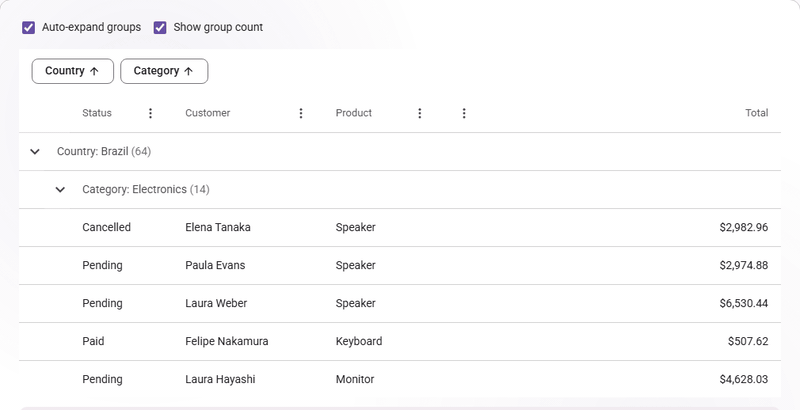
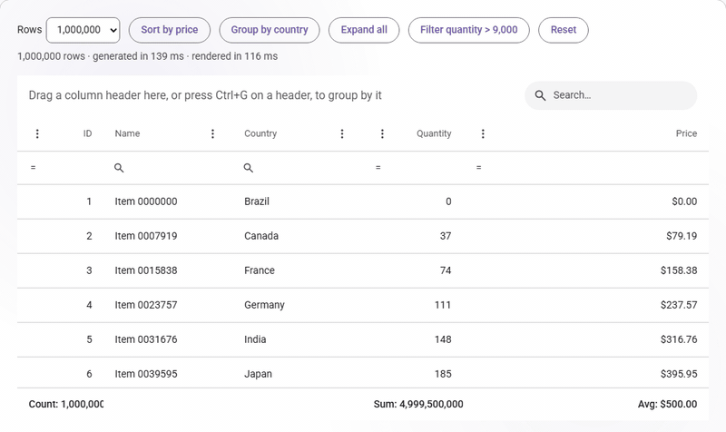
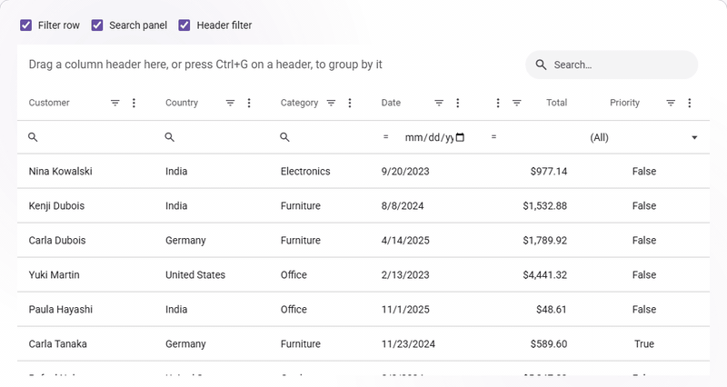
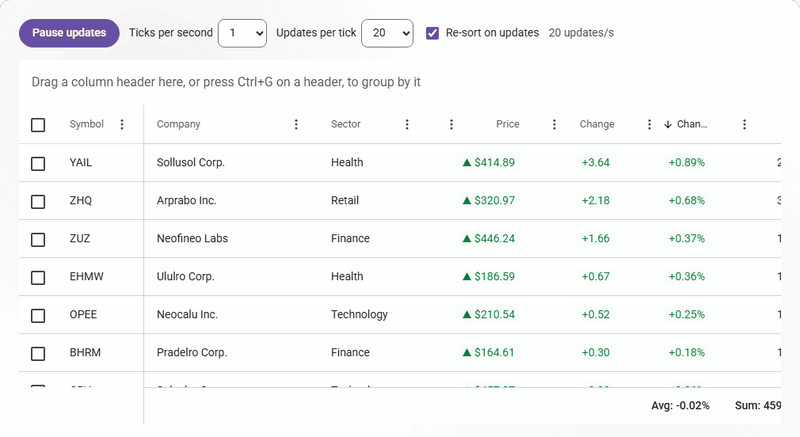
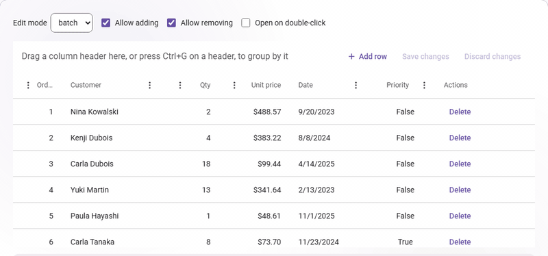

# `<u-grid>` — @universal-material/data-grid

[](https://www.npmjs.com/package/@universal-material/data-grid)
[](https://github.com/erichideyuki/universal-data-grid/blob/main/LICENSE)
[](https://github.com/sponsors/erichideyuki)

**A fast, accessible data grid as a standard Web Component.** `<u-grid>` is built with
[Lit](https://lit.dev) and belongs to the [Universal Material](https://universal-material.github.io/)
family. Because it is a native custom element, it works the same in plain HTML, Lit, Angular, React,
Vue or Svelte.

**[Live documentation and examples →](https://universal-material.github.io/data-grid/)**
&nbsp;·&nbsp; [Full API reference](https://github.com/erichideyuki/universal-data-grid/blob/main/API.md)
&nbsp;·&nbsp; [GitHub](https://github.com/erichideyuki/universal-data-grid)



---

## Highlights

- **Millions of rows.** Its own row virtualization renders only the visible rows. Sorting,
  grouping and expanding don't add per-row work, and the scroll range scales past the browser's
  maximum element height. Hundreds of columns can be virtualized as well, and the grid can scroll
  with the page or a parent panel (`scroll-container`) and still virtualize both.
- **Remote data.** A `dataSource` whose server filters, sorts, groups, summarizes and pages. Only the
  visible blocks load, with skeleton rows, a pager or infinite scrolling, a load panel and "Retry".
- **Shape the data.** Multi-column sorting, a filter row, a search panel, header filters, grouping by
  drag and drop (also by ranges), summaries, tree data and master-detail.
- **Editing.** Cell, row and batch modes, built-in editors per data type, your own editors, and
  synchronous or server-side validation. The grid never mutates your items: it hands you the
  changes to save.
- **Real-time updates.** `applyChanges()` patches rows in place and keeps selection, focus and
  expansion. With `reshapeOnChanges`, each batch re-applies filter, sort, groups and summaries, for
  live data that moves.
- **i18n in 14 languages, plus RTL.** Built-in translations, automatic language detection, `Intl`
  formatting of numbers and dates, global overrides, and full right-to-left layout (Arabic is
  built in).
- **Accessible.** Follows the WAI-ARIA APG grid (and treegrid) pattern for WCAG 2.2 AA. Full
  keyboard navigation survives virtualization, with screen reader announcements, and is checked
  with `axe-core`.
- **SSR.** Renders with `@lit-labs/ssr` and hydrates on the client. Templates can be
  server-rendered too.
- **Theming.** Material `--u-color-*` tokens, `--u-grid-*` custom properties, `::part`s and Lit
  templates for cells, headers, group rows and empty states.
- **Also included:** cell-range selection with copy and paste, column resize, pin, hide, bands and
  responsive auto-hide, a toolbar and context menus, state persistence, and export to CSV, Excel
  and tagged PDF.

## See it in action

| A million rows | Search and filter |
| --- | --- |
|  |  |
| **Real-time updates** | **Batch editing** |
|  |  |

Every GIF is recorded from the [live documentation](https://universal-material.github.io/data-grid/), where you can try each feature yourself.

## Install

```bash
npm i @universal-material/data-grid
```

The package is modern ESM with TypeScript declarations and a
[custom elements manifest](https://github.com/webcomponents/custom-elements-manifest).
`lit`, `@lit/context` and `interactjs` are regular dependencies, so your bundler shares them with
the rest of your app. Importing the package registers `<u-grid>` as a side effect.

## Quick start

### Plain HTML (no build step)

A self-contained bundle (Lit included) is published for CDNs. An import map lets you write the same
`import` as with npm:

```html
<script type="importmap">
  {
    "imports": {
      "@universal-material/data-grid": "https://cdn.jsdelivr.net/npm/@universal-material/data-grid@0.2/dist/grid.min.js"
    }
  }
</script>

<u-grid style="height: 400px"></u-grid>

<script type="module">
  import '@universal-material/data-grid';

  const grid = document.querySelector('u-grid');
  grid.columns = [
    { path: 'country', label: 'Country' },
    { path: 'year', label: 'Year', dataType: 'number', groupIndex: 0 },
    { path: 'population', label: 'Population', dataType: 'number' },
  ];
  grid.items = [
    { country: 'Brazil', year: 2022, population: 215313498 },
    { country: 'Japan', year: 2022, population: 124947000 },
  ];
</script>
```

> **Give the grid a height.** It fills its container (`height: 100%`), so the grid or its parent
> needs a defined height for the scroll area — unless it scrolls with the page or a parent
> ([`scroll-container`](https://github.com/erichideyuki/universal-data-grid/blob/main/API.md#scrolling-with-the-page-or-a-parent)).

### Lit

```ts
import { LitElement, html } from 'lit';
import { customElement } from 'lit/decorators.js';
import '@universal-material/data-grid';
import type { GridColumnDef } from '@universal-material/data-grid';

interface Order { id: number; customer: string; total: number }

@customElement('order-list')
export class OrderList extends LitElement {
  columns: GridColumnDef<Order>[] = [
    { path: 'customer', label: 'Customer' },
    { path: 'total', label: 'Total', dataType: 'number', format: { style: 'currency', currency: 'USD' } },
  ];

  items: Order[] = [{ id: 1, customer: 'Ana', total: 120 }];

  render() {
    return html`<u-grid style="height: 400px" key-expr="id" .columns=${this.columns} .items=${this.items}
      @u-grid-selection-change=${(e: CustomEvent) => console.log(e.detail)}></u-grid>`;
  }
}
```

### Other frameworks

Set `columns`, `items` and other objects as **properties** (not attributes), and listen to the
`u-grid-*` events: `[columns]` in Angular (with `CUSTOM_ELEMENTS_SCHEMA`), `columns={…}` in
React 19+, and `:columns.prop` in Vue. Import the package before the first render. Details are in
[Using with frameworks](https://github.com/erichideyuki/universal-data-grid/blob/main/API.md#using-with-frameworks).

## Documentation

- **[Live docs](https://universal-material.github.io/data-grid/)** have one runnable example per
  feature, with its source code.
- **[API.md](https://github.com/erichideyuki/universal-data-grid/blob/main/API.md)** is the complete
  guide and reference: every property, attribute, method, event, type, CSS custom property and
  part, by feature. Popular sections:
  [columns](https://github.com/erichideyuki/universal-data-grid/blob/main/API.md#defining-columns),
  [data sources and paging](https://github.com/erichideyuki/universal-data-grid/blob/main/API.md#data-sources-keys--paging),
  [real-time changes](https://github.com/erichideyuki/universal-data-grid/blob/main/API.md#refreshing-and-incremental-changes),
  [editing](https://github.com/erichideyuki/universal-data-grid/blob/main/API.md#editing),
  [i18n](https://github.com/erichideyuki/universal-data-grid/blob/main/API.md#internationalization-i18n),
  [accessibility](https://github.com/erichideyuki/universal-data-grid/blob/main/API.md#accessibility),
  [theming](https://github.com/erichideyuki/universal-data-grid/blob/main/API.md#theming),
  [SSR](https://github.com/erichideyuki/universal-data-grid/blob/main/API.md#server-side-rendering) and the
  [API tables](https://github.com/erichideyuki/universal-data-grid/blob/main/API.md#api-reference).
- `@universal-material/data-grid/custom-elements.json` describes the elements for IDEs and
  tooling.

## Browser support

Current evergreen browsers: Chrome and Edge 114+, Firefox 125+, and Safari 17+. The grid relies on
ES2022, the Popover API and modern CSS (`color-mix()`, `:has()`). Internet Explorer and legacy
Edge are not supported.

## Sponsor

If `<u-grid>` helps you, consider [sponsoring its development on GitHub](https://github.com/sponsors/erichideyuki).

## License

[MIT](https://github.com/erichideyuki/universal-data-grid/blob/main/LICENSE) © Eric Kono
